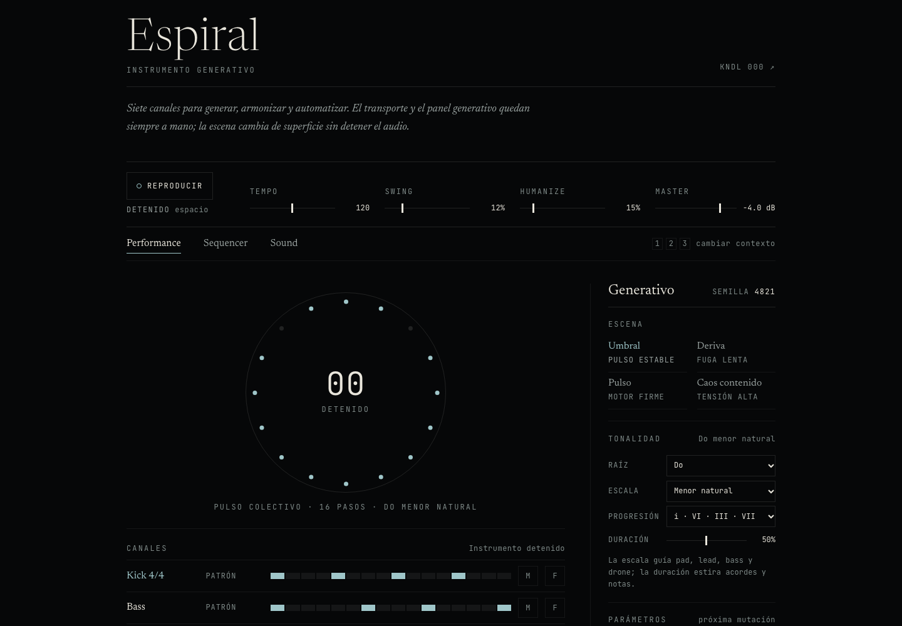

# Espiral

Instrumento generativo de ritmos, escalas y automatización.

[](https://quicio.github.io/espiral/)

- 16 tracks: kick, bass, hi-hat, perc, drone, pad, lead y 9 tracks de usuario sampler.
- Los tracks de usuario se pueden crear y eliminar; los 7 tracks del núcleo son fijos.
- Routing matrix track × bus con envíos PRE/POST, retorno por bus y dos buses por defecto.
- Mod matrix con LFO, macros y paso, aplicada a parámetros de plugins a control-rate.
- Performances por escenas: `Umbral`, `Deriva`, `Pulso`, `Caos contenido`.
- Semilla reproducible, Euclid, densidad, mutación, freeze y evolución.
- Tonalidad: 12 raíces, 7 escalas y 4 progresiones.
- Duración de notas para pad, lead y bass.
- Automatización de 16 pasos para reverb/delay.
- Sesiones locales y exportación/importación JSON.

## Desarrollo

```bash
npm install
npm run dev
```

Abrir la URL que imprime Vite. La app usa TypeScript, `@quicio/umbral-tone/generative`
para las reglas musicales y el motor modular de 16 tracks por defecto.

### Motores

El motor modular es el default. `ToneAudioEngine` queda como fallback legacy durante
la transición y para escucha A/B:

```bash
npm run dev:tone
VITE_ENGINE=tone npm run build
```

También se puede abrir `/modular.html` con `npm run dev`: es el experimento aislado de
2 tracks + 1 bus + 1 insert, con selector de plugins, parámetros generados desde el
schema y un plugin AudioWorklet. No entra en la build de producción.

## Build y tests

```bash
npm run build
npm run preview
npm test
npm run test:audio
```

`test:audio` renderiza la sesión en un `OfflineAudioContext` real y verifica peak,
NaN, DC y silencio. La primera vez requiere:

```bash
npx playwright install chromium
```

La build se publica en GitHub Pages en `https://quicio.github.io/espiral/`.

## Arquitectura

La regla de dependencia apunta hacia adentro: el dominio no conoce Tone.js, el DOM,
`localStorage` ni `fetch`. Ver [`docs/architecture.md`](docs/architecture.md) y los
specs del roadmap en [`docs/specs/`](docs/specs/).

- `src/domain/` — entidades, patrones, automatización y puertos. Sin frameworks.
- `src/application/` — casos de uso, store inmutable y servicios de reproducción/mezcla.
- `src/adapters/` — mapeo entre el estado y los formatos de sesión/preset.
- `src/infrastructure/` — Tone.js, audio, fetch, `localStorage` y descarga de archivos.
  El motor modular vive en `src/infrastructure/audio/modular/`; el PluginHost y los
  plugins built-in en `src/infrastructure/audio/plugins/`.
- `src/presentation/` — vistas DOM, controladores y presentadores.
- `src/main.ts` — composition root: elige las implementaciones y las inyecta.
- `src/espiral.css` — sistema visual del instrumento.
- `src/base.css` — base tipográfica, color y shell de la página.
- `public/audio/` — samples de batería y bajo.

El motor actual es `ToneAudioEngine` (implementa `AudioEnginePort`). Para reemplazarlo
por un motor modular con tracks, buses y plugins solo hay que crear otro adapter y
cambiarlo en `src/main.ts`.

## Licencia

MIT.
